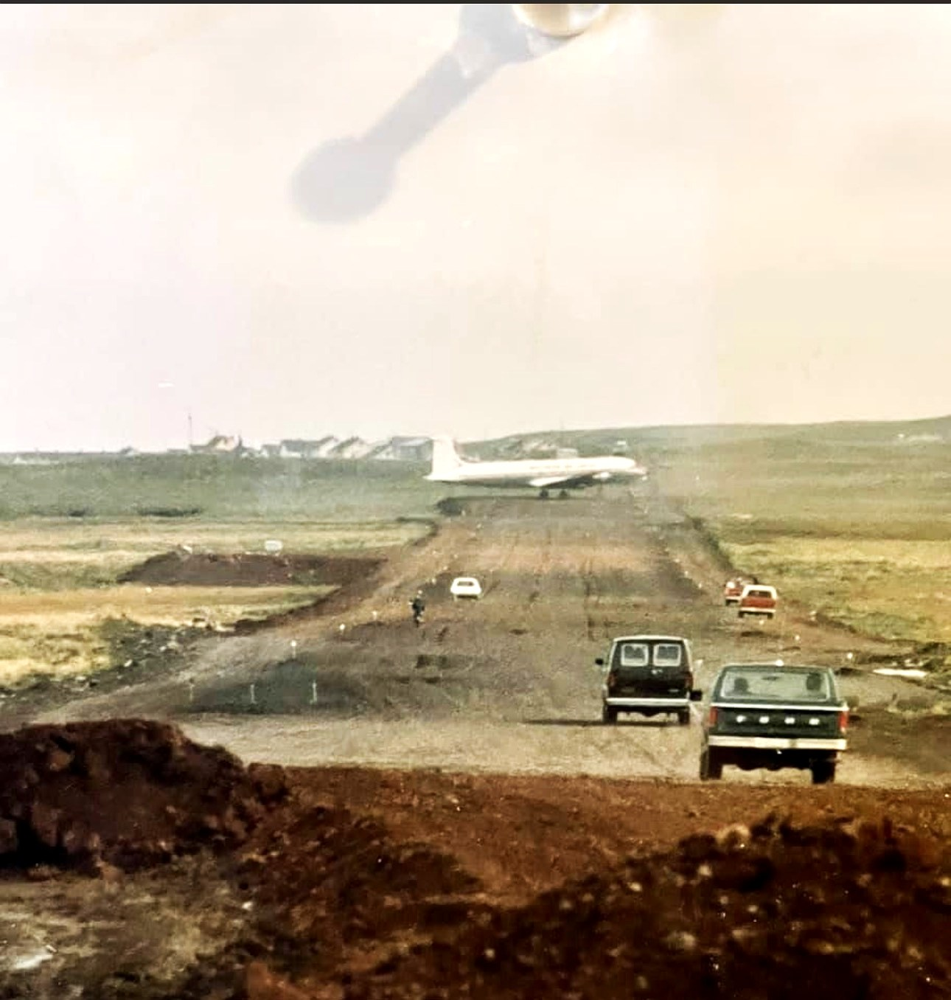

# PSTG – St. George Island, Old North Runway (MSFS 2024)

Scenery for **Microsoft Flight Simulator 2024** recreating the old north-side
gravel runway on St. George Island, Alaska (Pribilof Islands), as it was before
it closed in the early 1990s.

It is a separate add-on airport (**PSTG**) and does not replace the default
St. George airport (**PAPB**).

## At a glance

| | |
|---|---|
| Airport | PSTG – St. George Island, North side Runway |
| Runway | 08 / 26, about 4,175 ft (1,273 m), red scoria (volcanic gravel) |
| Weather (AWOS) | 132.325 MHz (Uses the PAPB METAR) |
| NDB / ADF | SRI, 391 kHz *(approximate, not the historical frequency)* |
| Fuel | 100 and Jet A |
| Parking | 2 small spots by the hangar (Navajo and smaller) |
| Tower / ILS / VASI | none – fly it visually |

## About the old runway

*The old strip in its working days, right after a DC-6 touched down. You can
see the fresh landing marks in the gravel, and the DC-6 at the far end turning
to taxi to the apron near the village. The runway was red scoria – a deep red
volcanic gravel. The camera doesn't pick up how red most of the strip really
was; the dirt in the foreground is closer to the true color.*

Until the early 1990s this short gravel strip was the main air link between
St. George Island and the mainland. It lay right beside the north side of
St. George village, close to the high cliffs on the northern shore and their
seabird colonies, so approaches passed very near houses and buildings.

In its heyday it handled scheduled service with DC-6s, C-130s, Beech 1900s and
Metroliners.

It was a difficult place to fly into. With high ground close by and the Bering
Sea just off the end, pilots met sudden fog, strong crosswinds and heavy
turbulence. Because the village was right alongside, there was no room to
lengthen it for larger cargo or emergency aircraft.

The strip was decommissioned around the end of 1992 to early 1993. The Alaska
DOT&PF built a new, larger St. George Airport (FAA: PBV, ICAO: PAPB), which
opened in 1993 and is the airport you will find in the sim by default.

## Download and install

1. Download the latest zip from the **[Releases](../../releases)** page
   (not the green "Code" button – that is the source).
2. Close MSFS 2024 and unzip.
3. Copy the folder `farwestlife-pstg-2025` into your **Community** folder.
   Press Windows key + R and paste one of these:
   - Microsoft Store / Xbox / Game Pass:
     `%LOCALAPPDATA%\Packages\Microsoft.Limitless_8wekyb3d8bbwe\LocalCache\Packages\Community`
   - Steam:
     `%APPDATA%\Microsoft Flight Simulator 2024\Packages\Community`
4. Start MSFS 2024 and search for **PSTG**.

### Optional: get the boats

The fishing fleet anchored off the runway and village, the harbor boats and
the Coast Guard vessels come from the free **Moving Boat Library 2024** by
superspud. Install it and you will see the same boats in the same places.
Without it the airport works exactly the same, but you will see almost no
boats (only one default trawler).

1. Open the library's page on flightsim.to:
   [Moving Boats 3D Model Library](https://flightsim.to/file/27908/moving-boats-3d-model-library)
   (you may need a free flightsim.to account to download).
2. Get the **MSFS 2024 version**, not the 2020 one: click the second
   download button (below the main one) and choose
   **`boat-library-moving-2024`**. It is a big file (about 420 MB).
3. Close MSFS 2024 and unzip the download.
4. Copy the folder **`boat-library-moving-2024`** into the same Community
   folder as `farwestlife-pstg-2025`. (If the zip has an extra folder around
   it, such as `ClickAgain`, copy only `boat-library-moving-2024`.) You can
   ignore the "For Developers" zip that comes with it.
5. Start MSFS 2024 and load in at PSTG. The boats should be on the water
   north of the runway and in the harbor to the southwest.

If the boats don't show, make sure the sim was fully restarted after you
added the library – the sim only loads add-ons when it starts.

The library is not included here because it is someone else's work –
please download it from the author's page.

### Updating and uninstalling

**Updating from an older version:** delete any old `PASG_2025` or
`farwestlife-pstg-2025` folder from Community first, so you do not get two
copies.

**Uninstall:** delete `farwestlife-pstg-2025` from your Community folder.

## Notes

- **Which end you start on:** MSFS puts you on the runway that faces the current
  wind. To start on the other end (08 = west, by the main apron and hangar;
  26 = east), change the wind direction in the weather settings before loading in.
- The island has no trees; none are added.
- The small concrete pad south of the runway was a real helipad. It is
  modeled as a plain concrete pad, not a sim helipad, because tools such as
  NeoFly treated the whole airport as helicopter-only when it was a helipad.
  Helicopters can still land on it.
- The sim's own road traffic may show a car or two on the strip. The strip was
  used as a road after it closed, and that road is in the sim's base map data.
- Dust on landing and takeoff depends on the aircraft.

## What's new

**1.3.0**
- Boats: 14 fishing ships anchored off the runway and village, a Coast Guard
  cutter on patrol to the north, and fishing boats, workboats and a small
  Coast Guard boat around the island (needs the optional boat library above).
- Removed the old land build-up at the east end of the runway that raised the
  ground and messed up the shoreline and sea level there.
- The airport position is now the middle of the runway, so tools such as
  NeoFly should recognize both ends (08 and 26) as PSTG.
- Magnetic variation set to 6° E; the SRI NDB sits at a more realistic height.
- Cleaned-up airport name, new thumbnail, author shown as Pribilof Hangar.

**1.1**
- The airport is PSTG (it was PASG). Red scoria runway with matching aprons,
  parking, fuel, AWOS 132.325 and the SRI NDB. Static aircraft removed; the
  runway sits properly on the ground.

## Help improve it

I grew up on St. George and took many flights off and on this runway.
I'm a novice scenery builder at best, though, so there is plenty that
someone with
more experience could do better – for example buildings, ground detail, a
proper taxi layout, or the real NDB frequency.

If you'd like to improve it, please **fork this repo** and send a pull
request, or open an issue with ideas, corrections or historical details.
Photos and memories of the old strip are very welcome too.

## Building from source

1. Install the MSFS 2024 SDK (Developer Mode → Help → SDK Installer).
2. In MSFS 2024, open the Project Editor and open `PSTG.xml` from this repo.
3. Click **Build All in project**. The package is written to
   `Packages/farwestlife-pstg-2025`.

The scenery source is `PackageSources/sceneries/PSTG.xml`.

## License

[CC BY-NC 4.0](LICENSE) – free to use, share and adapt with credit;
please do not sell it.

Scenery by Cal (Farwestlife / Pribilof Hangar). Uses default objects that come
with MSFS 2024. Boats are from the Moving Boat Library 2024 by superspud (not
included; download it separately).
