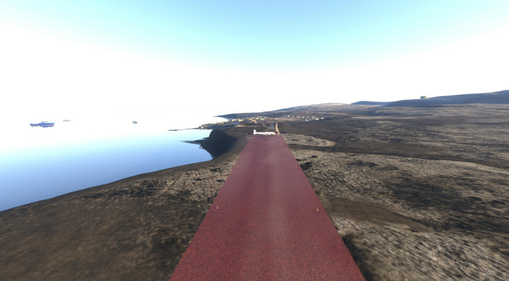
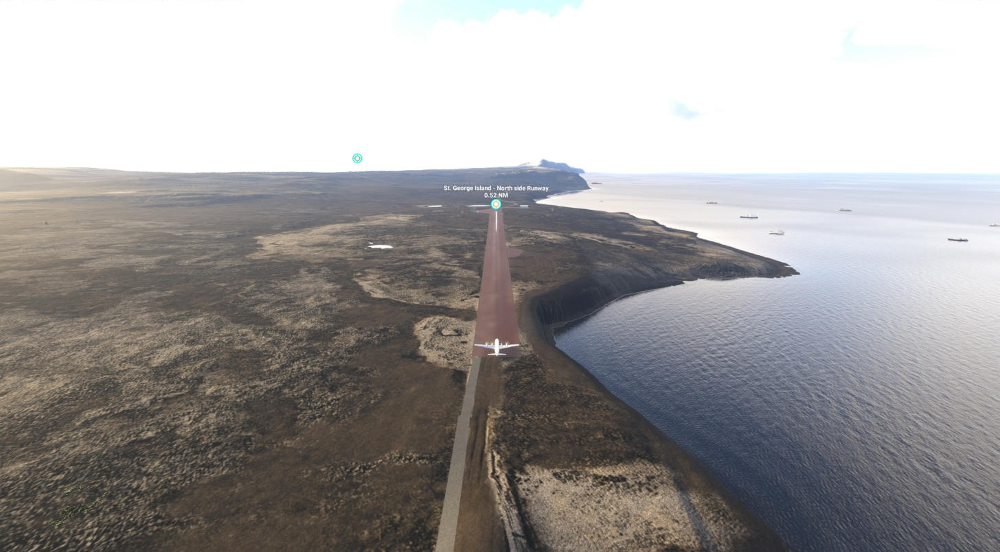
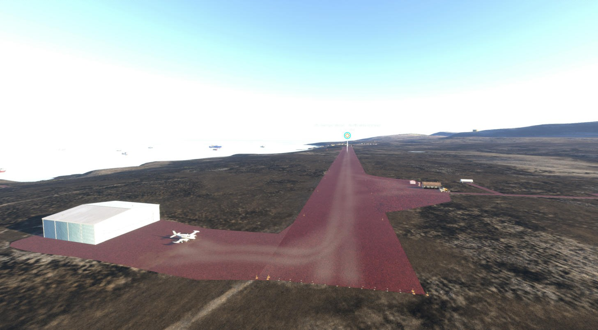

# PSTG – St. George Island, Old North Runway (MSFS 2024)

Scenery for **Microsoft Flight Simulator 2024** recreating the old north-side
gravel runway on St. George Island, Alaska (Pribilof Islands), as it was before
it closed in the early 1990s.

It is a separate add-on airport (**PSTG**) and does not replace the default
St. George airport (**PAPB**).

## At a glance

| | |
|---|---|
| Airport | PSTG – St. George Island, North side Runway |
| Runway | 08 / 26, about 4,175 ft × 125 ft (1,273 m × 38 m), red scoria (volcanic gravel) – no grass, flowers or road traffic on it |
| Weather (AWOS) | 132.325 MHz (Uses the PAPB METAR) |
| NDB / ADF | **PSTG, 391 kHz** – the old north-side beacon by the tanks *(approximate, not the historical frequency)* |
| PAPB NDB | **SRI, 399 kHz** – the real St. George beacon at the new airport, added because the default one never worked |
| Runway lights | Edge lights, end lights, ODALS on 26 – basic, like the 1980s |
| Fuel | 100 and Jet A |
| Parking | 2 small spots by the hangar (Navajo and smaller) |
| Tower / ILS / VASI | none – fly it visually |

## About the old runway

*The old strip in its working days, right after a DC-6 touched down. You can
see the fresh landing marks in the gravel, and the DC-6 at the far end turning
to taxi to the apron near the village. The runway was red scoria – a deep red
volcanic gravel. The camera doesn't pick up how red most of the strip really
was; the dirt in the foreground is closer to the true color.*

*This photo was taken before the runway was lengthened and widened. The
scenery models the later, longer and wider strip – about 4,175 ft long and
125 ft wide – so it looks a bit bigger than in the photo.*

*The same strip in MSFS 2024, looking down the runway toward the village, with
the cliffs and the fishing fleet off the north shore.*

*From the air: the strip running along the north shore toward the village.*

*The 08 end: the hangar apron, with the fuel site and gravel roads off to the
right.*

Until the early 1990s this short gravel strip was the main air link between
St. George Island and the mainland. It lay right beside the north side of
St. George village, close to the high cliffs on the northern shore and their
seabird colonies, so approaches passed very near houses and buildings.

In its heyday it handled scheduled service with DC-6s, C-130s, Beech 1900s and
Metroliners.

It was a difficult place to fly into. With high ground close by and the Bering
Sea just off the end, pilots met sudden fog, strong crosswinds and heavy
turbulence. Because the village was right alongside, there was no room to
lengthen it for larger cargo or emergency aircraft.

The strip was decommissioned around the end of 1992 to early 1993. The Alaska
DOT&PF built a new, larger St. George Airport (FAA: PBV, ICAO: PAPB), which
opened in 1993 and is the airport you will find in the sim by default.

## Download and install

1. Download the latest zip from the **[Releases](../../releases)** page
   (not the green "Code" button – that is the source).
2. Close MSFS 2024 and unzip.
3. Copy the folder `farwestlife-pstg-2025` into your **Community** folder.
   Press Windows key + R and paste one of these:
   - Microsoft Store / Xbox / Game Pass:
     `%LOCALAPPDATA%\Packages\Microsoft.Limitless_8wekyb3d8bbwe\LocalCache\Packages\Community`
   - Steam:
     `%APPDATA%\Microsoft Flight Simulator 2024\Packages\Community`
4. Start MSFS 2024 and search for **PSTG**.

Everything is built in: all the boats and ships use models that come with
MSFS 2024, so there is nothing else to download.

### Updating and uninstalling

**Updating from an older version:** delete any old `PASG_2025` or
`farwestlife-pstg-2025` folder from Community first, so you do not get two
copies.

**Uninstall:** delete `farwestlife-pstg-2025` from your Community folder.

## Notes

- **Which end you start on:** pick RWY 08 or RWY 26 under the departure on the
  World Map. MSFS 2024 may still switch you to the end that faces the wind, so if
  you want a particular end, set the wind first (08 starts at the west end by the
  hangar, facing east toward the village; 26 starts at the east end, facing west).
- The island has no trees; none are added.
- The small pad south of the runway is gravel now. The site was a jet fuel
  tank, which is what's there now.
- The runway no longer has the sim's road traffic on it.
- Some island roads from OpenStreetMap don't line up exactly with the sim's
  photo scenery. In a few spots you can still see the sim's own road next to
  ours.
- Dust on landing and takeoff depends on the aircraft.

## What's new

**1.5.1**
- East-end hills reshaped: one north–south ridge just past the 26 end, running
  from the cliff to the road, and the hump by the flashing light. The old
  east–west bands are gone.

**1.5.0**
- **Clean install, no extra downloads.** The fishing fleet, harbor boats and
  Coast Guard spots now use boats that come with MSFS 2024, in the same places
  (the optional Moving Boat Library is no longer needed). The fleet mixes
  colors so neighboring boats don't match.
- **Marine dock** at the village: the concrete jetty, with a light mast, a
  mobile crane and two small fishing boats tied up.
- **A few big ships** (cargo ships, oil tankers and a gas carrier) scattered
  10–20 nm south of the island, just for fun.
- **Smoother aprons:** the aprons no longer have the coarse "Mars rock"
  texture, and they match the runway.
- **Darker runway red**, closer to the real scoria.
- Road pieces inside the airport area filled in, and the old road at the 26 end
  now lines up with the road in the photo scenery.

**1.4.1**
- Runway is now 125 ft wide (measured from the real strip), with the edge lights
  about 125 ft apart and the red gravel ending at the lights.
- The one-story house by the fuel pump (it was used as a weather station) is back.
  The sim's own building there disappeared when the runway was widened, so the
  house is now part of the scenery and can't vanish again.
- Fixed a runway setting that could confuse which end you start on.

**1.4.0**

*The runway*
- The runway is now red gravel that the sim actually treats as gravel. Before,
  the dirt material reported as concrete, so tools like NeoFly saw a concrete
  airport.
- No more 3D grass, flowers or cars on the runway.
- The gravel reaches out to the edge lights, like the old photos.
- A darker, duller red that's closer to real scoria and no longer glows pink
  in bright light.
- Taxiway connected to the runway properly, and runway 26 heading corrected.
- Simple lighting: edge lights, end lights and the ODALS on 26.

*The ground around it*
- The east-end hills are back, but done properly this time: a ridge just past
  the end of 26, a hump by the flashing light, and a rise to the north, shaped
  as rounded hills instead of flat steps.
- Aprons trimmed so they no longer overlap the runway.

*Buildings and equipment*
- The old "helipad" was really a jet fuel tank site. It is now a horizontal
  jet fuel tank at the end of a gravel road.
- Fuel pump by the house, a big forklift and a flatbed truck.
- Gravel roads from the apron to the pad and the tank.

*Radio*
- The north-side NDB moved to where the real antenna stood, by the tanks, with
  a mast. It is now called **PSTG** on 391.
- New **SRI 399** NDB at PAPB with its own mast. The sim's default one never
  worked, in 2020 or 2024.

*The island*
- 72 island roads from OpenStreetMap painted over the sim's roads. Main roads
  are dark gray gravel; streets and tracks are red scoria. No rocks or boulders
  on them.

**1.3.0**
- Boats: 14 fishing ships anchored off the runway and village, a Coast Guard
  cutter on patrol to the north, and fishing boats, workboats and a small
  Coast Guard boat around the island (used the Moving Boat Library then;
  built-in boats since 1.5.0).
- Removed the old land build-up at the east end of the runway that raised the
  ground and messed up the shoreline and sea level there.
- The airport position is now the middle of the runway, so tools such as
  NeoFly should recognize both ends (08 and 26) as PSTG.
- Magnetic variation set to 6° E; the SRI NDB sits at a more realistic height.
- Cleaned-up airport name, new thumbnail, author shown as Pribilof Hangar.

**1.1**
- The airport is PSTG (it was PASG). Red scoria runway with matching aprons,
  parking, fuel, AWOS 132.325 and the SRI NDB. Static aircraft removed; the
  runway sits properly on the ground.

## Help improve it

I grew up on St. George and took many flights off and on this runway.
I am **not** a scenery developer. I didn't know what I was doing when I
started this, and it shows. Getting even this far took a lot of trial and
error: grass that kept coming back, hills that came out as flat "cookie
sheets", lights that wouldn't show up, and many, many sim restarts. A lot
of it was learned the hard way, with help from AI tools.

So please take this as a labor of love, not a finished product. **There is
still plenty of work to do:**

- A few edge lights are missing at the 26 end. Nobody has figured out why yet.
- Some island roads don't line up with the sim's photo scenery.
- No Russian Orthodox church. There's no suitable model in the sim, so it
  would need a custom 3D model.
- The real village buildings, the old terminal and hangar aren't modeled.
- The real 1980s NDB frequency and ident are unknown. PSTG 391 is a guess.
- The hills are close to how I remember them, but not survey-accurate.
- The runway and road edges are perfectly straight with square corners.
  Real gravel has ragged edges and spill. That needs hand-drawn edge
  patches or custom soft-edge textures.

If you know scenery building, please **fork this repo** and send a pull
request, or open an issue with ideas, corrections or history. Photos and
memories of the old strip are very welcome. And if something looks wrong,
it probably is. Tell me.

## Building from source

1. Install the MSFS 2024 SDK (Developer Mode → Help → SDK Installer).
2. In MSFS 2024, open the Project Editor and open `PSTG.xml` from this repo.
3. Click **Build All in project**. The package is written to
   `Packages/farwestlife-pstg-2025`.

The scenery source is `PackageSources/sceneries/PSTG.xml`.

## License

[CC BY-NC 4.0](LICENSE) – free to use, share and adapt with credit;
please do not sell it.

Scenery by Cal (Farwestlife / Pribilof Hangar). Uses default objects that come
with MSFS 2024, including all boats and ships.

Island roads are based on map data © OpenStreetMap contributors, available
under the Open Database License
([openstreetmap.org/copyright](https://www.openstreetmap.org/copyright)).
